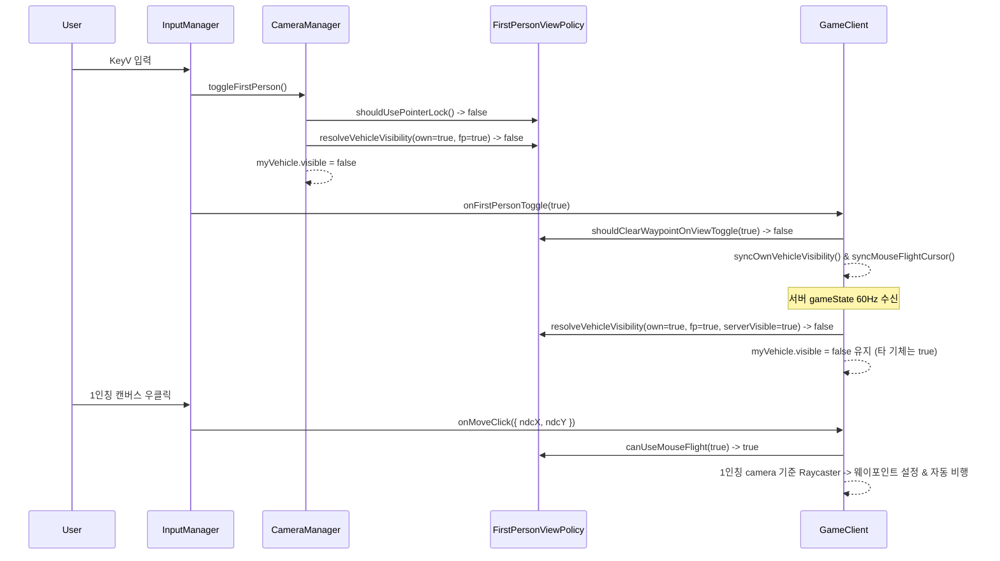

# 1인칭 시점 전환 시 내 기체 숨김 및 마우스 이동 지원 설계서

## 1. 원인 분석 (Root Cause Analysis)
1. **내 기체가 1인칭 시야를 가리는 원인**:
   - `CameraManager.toggleFirstPerson()`에서 `this.myVehicle.visible = false`를 1회 설정하지만, 직후 서버 `gameState` 업데이트(`GameClient.updateGameState()`, `onVehicleRespawned()`)가 매 틱 `vehicle.visible = vehicleData.visible` (또는 `vehicleData.active`)로 덮어써 내 기체가 다시 화면에 렌더링되었다.
2. **1인칭 시점에서 마우스 이동이 동작하지 않는 원인**:
   - `CameraManager.toggleFirstPerson()`이 `document.body.requestPointerLock()`을 호출해 커서를 잠그고 숨겼다. (현재 1인칭 카메라는 기체 전방 회전을 따르며 포인터 락 마우스 델타를 사용하지 않음)
   - `InputManager`의 `mousedown` 핸들러, `GameClient.handleMouseMoveCommand()`, `GameClient.syncMouseFlightCursor()`가 `!this.isFirstPerson` 조건으로 1인칭 입력과 커서를 차단했다.
   - `GameClient`의 `onFirstPersonToggle` 콜백이 1인칭 진입 시 `clearMouseFlightTarget()`을 호출해 활성 웨이포인트를 취소했다.

## 2. 아키텍처 및 SOLID 설계

### 2.1 신규 순수 정책 모듈: `client/js/camera/FirstPersonViewPolicy.js` (SRP / DIP)
DOM과 Three.js에 의존하지 않는 순수 정책 클래스로, 설정(`game-config.yaml`)에 따라 다음을 결정한다:
- `shouldHideOwnVehicle()`: `camera.firstPerson.hideOwnVehicle !== false`
- `shouldUsePointerLock()`: `camera.firstPerson.usePointerLock === true` (기본 `false`)
- `canUseMouseFlight(isFirstPerson)`: `mouseFlight.enabled !== false && (!isFirstPerson || mouseFlight.allowInFirstPerson !== false)`
- `shouldClearWaypointOnViewToggle(isFirstPerson)`: `Boolean(isFirstPerson && !this.allowMouseFlightInFirstPerson)`
- `resolveVehicleVisibility({ isOwnVehicle, isFirstPerson, serverVisible = true, isInvulnerable = false, blinkVisible = true })`:
  1. `isOwnVehicle && isFirstPerson && this.hideOwnVehicle` → `false`
  2. `!serverVisible` → `false`
  3. `isInvulnerable` → `Boolean(blinkVisible)`
  4. 그 외 → `true`

### 2.2 모듈별 책임 변경
| 모듈 | 변경 내용 |
|---|---|
| `services/game-service/src/config/game-config.yaml` | `camera.firstPerson.hideOwnVehicle: true`, `camera.firstPerson.usePointerLock: false`, `client.mouseFlight.allowInFirstPerson: true` 추가 |
| `client/js/camera/CameraManager.js` | `FirstPersonViewPolicy` 주입/사용. `toggleFirstPerson()`에서 정책에 따라 포인터 락 조건부 호출 및 내 기체 가시성 적용 |
| `client/js/input/InputManager.js` | 옵션 `allowFirstPersonMouseFlight`, `usePointerLockInFirstPerson` 수신. `mousedown`에서 1인칭 마우스 이동 허용 |
| `client/js/GameClient.js` | `FirstPersonViewPolicy` 생성·연동. `resolveVehicleVisibility()` 헬퍼를 `createVehicle`, `updateGameState`, `onVehicleRespawned`, `updateInvulnerabilityVisuals`, `onFirstPersonToggle` 전체에 일관 적용. `handleMouseMoveCommand`, `syncMouseFlightCursor`에서 정책 메서드 사용 |

## 3. 시퀀스 흐름

## 4. 테스트 전략
1. **단위 테스트 (`services/game-service/tests/unit/first-person-view-policy.test.js`)**:
   - 기본 설정 및 커스텀 설정에서의 `resolveVehicleVisibility` (내 기체 1인칭 숨김, 타 기체 유지, 3인칭 복원, 서버 파괴/비활성 유지, 무적 깜빡임 조합)
   - `shouldUsePointerLock`, `canUseMouseFlight`, `shouldClearWaypointOnViewToggle` 검증
2. **E2E 테스트 (`tests/e2e/mouse-flight-control.spec.js` 확장)**:
   - 실제 `http://localhost` Docker 스택에서 게스트 로그인 → 게임 참가 → `V` 키 1인칭 전환
   - 여러 서버 `gameState` 업데이트 대기 후에도 `myVehicle.visible === false` 유지 확인
   - 1인칭 상태에서 `.mouse-flight-enabled` 커서 유지, 우클릭으로 웨이포인트 생성·마커 표시·조향 및 실제 기체 이동 확인
   - `V` 키 3인칭 복귀 시 `myVehicle.visible === true` 복원 확인
