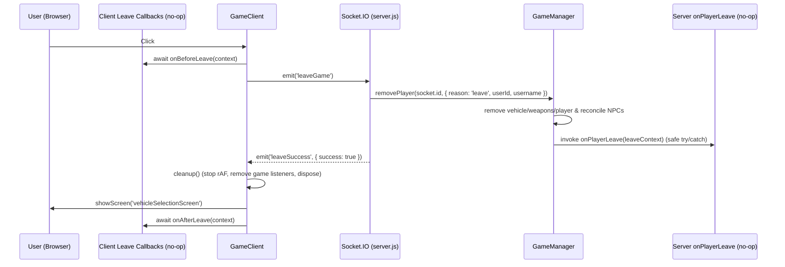

# 게임 나가기(Leave Game) 상세 설계서

- **문서 버전:** v1.0
- **작성일:** 2026-11-24
- **대상 브랜치:** `stabilization`
- **연관 문서:** [LEAVE_GAME_REQUIREMENTS.md](./LEAVE_GAME_REQUIREMENTS.md)

---

## 1. 시퀀스 흐름

---

## 2. 모듈별 상세 설계 (SOLID)

### 2.1 서버 콜백 모듈 (`services/game-service/src/services/hooks/PlayerLeaveCallback.js`)
- `defaultOnPlayerLeave(context)`: 현재는 빈 깡통 `async () => {}` 함수.
- `createSafeLeaveInvoker(callback = defaultOnPlayerLeave)`:
  - 전달받은 콜백을 `Promise.resolve().then(() => callback(context))` 형태로 안전하게 실행하며 예외 발생 시 경고 로그만 남기고 게임 로직을 중단시키지 않는다. (SRP / DIP)

### 2.2 `GameManager` 확장 (`services/game-service/src/services/GameManager.js`)
- 생성자 `options.onPlayerLeave` 주입 지원 (기본값: `defaultOnPlayerLeave`).
- `setOnPlayerLeave(callback)`: 런타임 콜백 교체 가능 (OCP / DIP).
- `removePlayer(playerId, options = {})`:
  - `existingPlayer`가 존재하지 않으면 `false` 반환 (멱등성 — 중복 제거/중복 콜백 방지).
  - 인간 유저(`!wasNpc && !options.fromNpcManager`)가 실제로 제거될 때 `leaveContext`를 구성하여 `this.invokePlayerLeave(leaveContext)` 호출.

### 2.3 `server.js` 소켓 이벤트 추가 (`services/game-service/src/server.js`)
- `socket.on('leaveGame', () => { ... })`:
  - `const removed = gameManager.removePlayer(socket.id, { reason: 'leave', userId: socket.userId, username: socket.username });`
  - `socket.emit('leaveSuccess', { success: true, removed });`
- `socket.on('disconnect', () => { ... })`:
  - `gameManager.removePlayer(socket.id, { reason: 'disconnect', userId: socket.userId, username: socket.username });`
  - 이미 `leaveGame`으로 제거된 소켓이면 `removePlayer`가 `false`를 반환해 콜백이 중복 호출되지 않는다.

### 2.4 클라이언트 콜백 모듈 (`client/js/callbacks/leaveCallbacks.js`)
- `defaultOnBeforeLeave(context)`: 빈 깡통 `async () => {}` 함수.
- `defaultOnAfterLeave(context)`: 빈 깡통 `async () => {}` 함수.
- `invokeSafeLeaveCallback(fn, context)`: 예외 격리 실행 헬퍼.

### 2.5 `NetworkManager`, `UIManager`, `GameClient`, `index.html` 정리
- `NetworkManager`: 등록한 이벤트 핸들러 목록(`this.boundHandlers`)을 저장하고 `cleanup()`에서 `socket.off(event, handler)`만 호출(로비 리스너 보존).
- `UIManager`: `cleanup()`에서 `this.elements.targetingContainer` DOM 제거 및 `this.targetBoxes.clear()`.
- `GameClient`:
  - `this.isRunning = true`, `this.animationFrameId = null`, `this.boundOnWindowResize = () => this.onWindowResize()`.
  - `cleanup()`: `isRunning = false`, `cancelAnimationFrame`, `window.removeEventListener('resize', ...)`, 각 매니저 `cleanup()`, `renderer.dispose()`.
- `client/index.html`:
  - `#gameUI` 내 `#leaveGameBtn` 버튼 추가.
  - `leaveGame()` 함수: `onBeforeLeave` → `socket.emit('leaveGame')` (`leaveSuccess` 대기, 최대 2초 타임아웃 폴백) → `gameClient.cleanup()` → `showScreen('vehicleSelectionScreen')` → `onAfterLeave`.

---

## 3. 테스트 전략
1. **단위/통합 테스트 (`services/game-service/tests/integration/leave-game.test.js`)**:
   - 기본(no-op) 콜백 정상 동작
   - 커스텀 `onPlayerLeave` 콜백이 `leaveContext`와 함께 정확히 1회 호출되는지 검증
   - 콜백이 예외/reject를 발생시켜도 `removePlayer` 및 NPC 정리가 정상 완료되는지 검증
   - `leaveGame` 후 `disconnect` 발생 시 콜백 중복 호출 방지(멱등성) 검증
2. **Playwright Headless Browser E2E (`tests/e2e/leave-game.spec.js`)**:
   - 로그인 → 게임 입장 → `#leaveGameBtn` 클릭 → 차량 선택 화면 복귀 확인
   - 나가기 직후 서버 `/api/game/api/status`에서 `humanPlayers: 0, npcPlayers: 0, gameState: 'waiting'` 확인
   - 클라이언트 `onBeforeLeave` / `onAfterLeave` 콜백 호출 확인
   - 같은 세션에서 바로 `게임 참가` 재클릭 → 정상 재입장 및 `#targetingContainer` 중복 없음 확인
