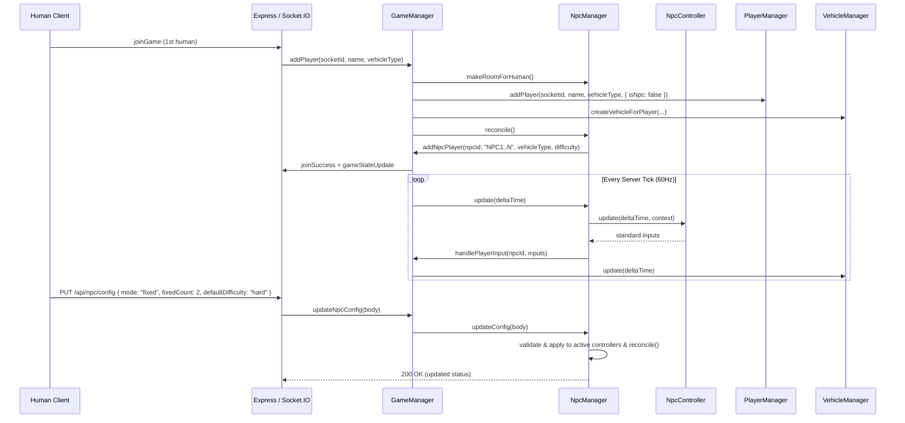

# NPC Player 상세 설계서

- **문서 버전:** v1.0
- **작성일:** 2026-11-24
- **대상 브랜치:** `stabilization`
- **연관 문서:** [NPC_PLAYER_REQUIREMENTS.md](./NPC_PLAYER_REQUIREMENTS.md)

---

## 1. 아키텍처 개요 (SOLID 준수 구조)

기존 `game-service`의 SOLID 원칙(SRP/OCP/LSP/ISP/DIP)을 엄격히 준수하도록 NPC 시스템을 아래와 같이 단일 책임 모듈과 추상 인터페이스(전략·정책·포트)로 분리한다.

- **AI 계층 (`services/game-service/src/ai/`)**
  - `FlightSteering`: 3D `YXZ` 오일러 좌표계 기반 목표점 조향 및 시야각 계산 전담 (SRP)
  - `ObstacleAvoidance`: 지형·맵 경계·광고판 안전 회피 감지 전담 (SRP/OCP)
  - `NpcController`: 개별 NPC의 FSM, 반응 시간 지연(`reactionTimeMs`), 전투 의사결정 전담 (`FlightSteering`, `ObstacleAvoidance` 주입 — DIP)
- **NPC 도메인 서비스 (`services/game-service/src/services/npc/` & `NpcManager.js`)**
  - `NpcSpawnStrategy` (`FillSpawnStrategy`, `FixedSpawnStrategy`): 운영 모드별 목표 NPC 수 및 교체 가능 여부 전략 인터페이스 (OCP/LSP — `registerStrategy()`로 수정 없이 신규 모드 확장)
  - `NpcConfigManager`: 설정 스키마, 동적 난이도 프리셋 레지스트리, 패치 유효성 검증, 비행체/난이도 선택 전담 (SRP/OCP)
  - `NpcEvictionPolicy`: 유저 입장 시 제거 대상 NPC 선정 우선순위 정책 전담 (SRP/OCP)
  - `NpcManager`: NPC 생명주기 및 틱 오케스트레이션 전담. `GameManager` 구체 클래스에 직접 의존하지 않고 최소한의 포트 인터페이스(`worldPort`)와 `controllerFactory`를 주입받음 (ISP/DIP)
- **HTTP 라우팅 (`services/game-service/src/routes/npcRoutes.js`)**
  - `GET/PUT /api/npc/config` HTTP 입출력만 담당하는 독립 Express Router (SRP)



---

## 2. 모듈별 상세 설계

### 2.1 `PlayerManager` 확장 (`services/game-service/src/services/PlayerManager.js`)

#### 데이터 모델 변경
```js
const player = {
    id: playerId,
    name: playerName,
    score: 0,
    kills: 0,
    deaths: 0,
    color: color,
    vehicleType: vehicleType,
    isNpc: Boolean(options.isNpc),
    difficulty: options.isNpc ? (options.difficulty || 'normal') : null,
    joinedAt: Date.now(),
    awarenessTargetId: null,
    lockOnTargetId: null,
    lockOnState: { isLocked: false, progress: 0 }
};
```

#### 추가 메서드
- `addPlayer(playerId, playerName, vehicleType = 'fighter', options = {})`: `isNpc`, `difficulty` 지원 (기존 호출부와 하위 호환 유지).
- `getHumanPlayers()`: `isNpc === false`인 플레이어 배열 반환.
- `getNpcPlayers()`: `isNpc === true`인 플레이어 배열 반환.
- `getHumanCount()`: 실제 유저 수 반환.
- `getNpcCount()`: NPC 수 반환.

---

### 2.2 `NpcController` 설계 (`services/game-service/src/ai/NpcController.js`)

#### 좌표계 및 물리 정합성 (Three.js `YXZ` 오일러 기준)
`Vehicle.js`는 `rotation.order = 'YXZ'`이며 초기 전방 벡터는 `(0, 0, +1)`이다.
- **Yaw (`rotation.y`):**
  - 전방 수평 성분: $(\sin y,\; \cos y)$
  - 목표 방위각: $\text{desiredYaw} = \text{atan2}(\Delta x,\; \Delta z)$
  - 최단 회전 오차: $\text{yawDiff} = \text{normalizeAngle}(\text{desiredYaw} - \text{rotation.y}) \in [-\pi, \pi]$
  - `Vehicle.js`에서 `rotation.y += inputs.yaw * yawSpeed * dt`이므로 `yawDiff > 0`일 때 `inputs.yaw > 0`.
- **Pitch (`rotation.x`):**
  - Three.js 오른손 좌표계에서 `(0, 0, 1)`에 X축 회전 $+x$를 적용하면 $y' = -\sin(x),\; z' = \cos(x)$.
  - 따라서 **양수 `rotation.x`는 기수 하강**, **음수 `rotation.x`는 기수 상승**을 의미한다.
  - 목표 피치각: $\text{desiredPitch} = -\text{atan2}(\Delta y,\; \sqrt{\Delta x^2 + \Delta z^2})$
  - `pitchDiff = desiredPitch - rotation.x`로 `inputs.pitch` 산출.
- **Roll (`rotation.z`):**
  - 선회 시 자연스러운 기울임 연출: `inputs.roll = clamp(-inputs.yaw * 0.5, -1, 1)` (직진 시 수평 복귀).

#### 반응 시간(`reactionTimeMs`) 및 판단 주기(`decisionIntervalMs`) 모델
- `constructor(npcId, difficultyName, profile, worldConfig, deps = {})`
  - 테스트 결정성 확보를 위해 `deps.now = Date.now`, `deps.random = Math.random` 주입 지원.
- **반응 시간 지연 메커니즘:**
  - 새로운 적을 타겟으로 포착한 시점(`targetAcquiredAt`)으로부터 `profile.reactionTimeMs`가 경과하기 전에는 `ENGAGE` 사격을 개시하지 않는다.
  - 피격(`onHit(attackerId, now)`) 발생 시 즉시 `evadeTriggerAt = now + profile.reactionTimeMs`를 예약하고, 해당 시각이 도래하면 `EVADE` 상태로 전이한다.
  - 미사일 락온 완료 시점(`lockAcquiredAt`)으로부터 `profile.missileReactionMs`가 경과한 뒤 `missileUseChance` 판정으로 `fireMissile: true`를 출력한다.
- **조준 오차 및 리드샷:**
  - 타겟 위치 예측: $\vec{p}_{\text{aim}} = \vec{p}_{\text{target}} + \vec{v}_{\text{target}} \cdot \frac{d}{v_{\text{bullet}}} \cdot \text{leadTargetFactor}$
  - `aimErrorDeg` 범위 내 오프셋을 의사결정 주기(`decisionIntervalMs`)마다 갱신하여 조향 목표각에 반영한다(Easy일수록 흔들리고 Hard일수록 정밀).
- **연사/휴지 패턴:**
  - `ENGAGE` 상태에서 `fireBurstMs` 동안 `fire: true`, 이후 `fireRestMs` 동안 `fire: false`를 반복한다.

#### 최우선 안전 회피 (`AVOID_OBSTACLE`)
매 틱(60Hz) 경량 검사 수행:
1. **지형 고도 검사:** 현재 위치 및 전방 25유닛 예측 위치에서 `terrainHeight + 25` 미만이면 즉시 상승 목표점 설정 + `vertical = 1`.
2. **맵 경계 검사:** `|x| > limit` 또는 `|z| > limit` (`limit = world.size / 2 - boundaryBuffer - 35`) 또는 `y > world.maxHeight - 25`이면 맵 중앙 `(0, 100, 0)` 방향으로 강제 복귀.
3. **광고판 회피:** 활성 `Billboard` 중심과 거리 `< Math.max(width, height) * 0.75 + 15` 이내로 접근 시 광고판 반대편·상방 벡터로 회피.

---

### 2.3 `NpcManager` 설계 (`services/game-service/src/services/NpcManager.js`)

#### 주요 책임
1. **설정 관리 및 검증 (`validateConfigPatch`, `updateConfig`)**
   - 허용 필드: `enabled` (boolean), `mode` (`"fill"` | `"fixed"`), `fixedCount` (정수 `0 <= n <= maxPlayers`), `prioritizeHumans` (boolean), `defaultDifficulty` (`"easy"` | `"normal"` | `"hard"` | `"mixed"`), `difficultyWeights` (양수 합 > 0), `difficulties` (각 난이도별 숫자 필드 범위 검증).
   - 검증 실패 시 `{ success: false, errors: [...] }` 반환 (기존 설정 유지).
   - 검증 성공 시 설정 병합 → 활성 NPC 컨트롤러의 난이도 프로필 즉시 갱신 → `reconcile()` 호출 → `{ success: true, status }` 반환.
2. **목표 인원 계산 (`calculateTargetNpcCount(humanCount)`)**
   ```js
   if (!this.npcConfig.enabled) return 0;
   if (humanCount === 0 && !this.npcConfig.keepAliveWhenEmpty) return 0;
   if (this.npcConfig.mode === 'fill') {
       return Math.max(0, this.maxPlayers - humanCount);
   }
   // mode === 'fixed'
   const desired = Math.max(0, Math.min(this.npcConfig.fixedCount, this.maxPlayers));
   if (this.npcConfig.prioritizeHumans) {
       return Math.min(desired, Math.max(0, this.maxPlayers - humanCount));
   }
   return desired;
   ```
3. **슬롯 확보 (`makeRoomForHuman`)**
   - 유저 입장 직전 호출.
   - `totalPlayers >= maxPlayers`이고 `controllers.size > 0`이며, `mode === 'fill'`이거나 `(mode === 'fixed' && prioritizeHumans)`이면 우선순위에 따라 NPC 1명을 즉시 제거한다.
4. **제거 우선순위 (`selectNpcToRemove`)**
   - 1순위: `!vehicle.active` (파괴되어 리스폰 대기 중인 NPC)
   - 2순위: 최근 5초 이내 피격/교전 이력이 없는 NPC
   - 3순위: 가장 먼저 생성된(`createdAt`이 최소인) NPC
5. **순번 네이밍 (`allocateNpcNumber`, `releaseNpcNumber`)**
   - `usedNumbers` Set에서 `1`부터 탐색하여 미사용 최소 정수 반환 → `${namePrefix}${num}` (`NPC1`, `NPC2`, ...).
   - NPC 제거 시 해당 번호 반환.
6. **비행체/난이도 선택**
   - 비행체: `vehicleTypes` (`["fighter", "heavy"]`) 중 균등 랜덤 선택.
   - 난이도: `defaultDifficulty === 'mixed'`이면 `difficultyWeights` 기반 가중치 랜덤 선택, 아니면 `defaultDifficulty` 사용.

---

### 2.4 `GameManager` 연동 (`services/game-service/src/services/GameManager.js`)

- 생성자:
  - `this.respawnTimers = new Map();` 추가 (플레이어 ID별 리스폰 타이머 추적).
  - `this.npcManager = new NpcManager(config, this, options.npcDeps);` 생성.
  - 테스트에서 `autoStartLoop: false` 옵션으로 `setInterval` 없이 수동 틱(`update()`) 실행 가능하도록 지원.
- `addPlayer(playerId, playerName, vehicleType = 'fighter', options = {})`:
  - `!options.isNpc`인 경우 `this.npcManager.makeRoomForHuman()` 먼저 호출.
  - 기존 `playerManager.addPlayer`, `vehicleManager.createVehicleForPlayer`, `weaponSystem.equipWeapon` 수행.
  - `!options.isNpc`인 경우 `this.gameStateManager.updatePlayerCount(this.playerManager.getHumanCount())` 후 `this.npcManager.reconcile()` 호출.
- `removePlayer(playerId)`:
  - `this.respawnTimers.get(playerId)`가 있으면 `clearTimeout` 후 삭제 (유령 리스폰 방지).
  - 플레이어 `isNpc` 여부를 삭제 전에 확인.
  - 차량/무기/플레이어 제거.
  - `!wasNpc`인 경우 `this.npcManager.reconcile()` 및 `this.gameStateManager.updatePlayerCount(this.playerManager.getHumanCount())` 호출.
- `handleVehicleDestroyed(vehicle, collision)`:
  - `setTimeout` 핸들을 `this.respawnTimers.set(vehicle.playerId, timerId)`에 저장하고, 콜백 실행 시 `this.vehicleManager.getVehicle(vehicle.id)` 존재 여부 재확인 후 리스폰.
- `handleVehicleHit(collision)`:
  - 피격 차량이 NPC 소유이면 `this.npcManager.notifyNpcHit(vehicle.playerId, collision.ownerId)` 호출.
- `update(fixedDeltaTime = null)`:
  - `gameState === 'playing'`일 때 `this.npcManager.update(deltaTime)` 실행 후 `vehicleManager.update(deltaTime)` 등 기존 루프 수행.

---

### 2.5 REST API 설계 (`services/game-service/src/index.js`)

| Method | Path (`game-service`) | Nginx 경유 경로 (JWT 필요) | 설명 |
|---|---|---|---|
| `GET` | `/api/npc/config` | `GET /api/game/api/npc/config` | 현재 NPC 설정 및 활성 NPC 목록 조회 |
| `PUT` | `/api/npc/config` | `PUT /api/game/api/npc/config` | 런타임 NPC 모드/개수/난이도/능력치 동적 변경 |
| `GET` | `/api/status` | `GET /api/game/api/status` | 기존 상태 응답에 `humanPlayers`, `npcPlayers`, `npc` 필드 추가 |

#### `PUT /api/npc/config` 요청 예시
```json
{
  "mode": "fixed",
  "fixedCount": 2,
  "defaultDifficulty": "hard",
  "difficulties": {
    "hard": {
      "reactionTimeMs": 80
    }
  }
}
```

#### 성공 응답 (`200 OK`)
```json
{
  "success": true,
  "config": { "...": "..." },
  "activeNpcs": [
    { "id": "npc_...", "name": "NPC1", "vehicleType": "fighter", "difficulty": "hard", "state": "PATROL" },
    { "id": "npc_...", "name": "NPC2", "vehicleType": "heavy", "difficulty": "hard", "state": "CHASE" }
  ],
  "counts": {
    "human": 1,
    "npc": 2,
    "total": 3,
    "maxPlayers": 8
  }
}
```

#### 실패 응답 (`400 Bad Request`)
```json
{
  "success": false,
  "error": "Invalid NPC configuration",
  "details": ["mode must be 'fill' or 'fixed'"]
}
```

---

### 2.6 클라이언트 UI 설계 (`client/js/ui/UIManager.js`)

- `updatePlayerList(vehicles)`:
  - `player.isNpc === true`인 경우 이름 옆에 NPC 식별 배지 표시 (예: `🤖 NPC1 [normal]`).
  - 기존 본인(`(나)`) 표시 및 체력/점수 표시 구조 유지.

---

## 3. 테스트 전략 (TDD + Playwright E2E)

### 3.1 단위 테스트 (`services/game-service/tests/unit/`)
Node.js 내장 테스트 러너(`node --test`) 사용:
1. `npc-controller.test.js`
   - `reactionTimeMs` 경과 전/후 사격 및 회피 지연 검증 (Easy vs Hard 차이)
   - `aimErrorDeg` 및 `leadTargetFactor` 반영 검증
   - 지형 고도 저하 / 맵 경계 근접 / 광고판 근접 시 `AVOID_OBSTACLE` 최우선 발동 검증
   - `YXZ` 오일러 기준 상승(`pitch < 0`)·하강(`pitch > 0`)·좌우 선회(`yaw`) 조향 방향 정확성 검증
   - 락온 완료 후 `missileReactionMs` 경과 시 미사일 발사 검증
2. `npc-manager.test.js`
   - `fill` 모드: 유저 0→1→2→8→9명 입장 및 퇴장 시 NPC 자동 증감 및 정원 제어
   - `fixed` 모드: `fixedCount` 유지, 정원 초과 시 `prioritizeHumans` 축소 및 복구
   - 유저 0명 시 NPC 전원 제거(`keepAliveWhenEmpty: false`)
   - 네이밍(`NPC1`, `NPC2`, ...) 최소 미사용 순번 재할당 검증
   - 비행체 타입(`fighter`, `heavy`) 혼합 생성 검증
   - 제거 우선순위(리스폰 대기 중 NPC 우선 제거) 검증
   - `updateConfig` 유효성 검증 및 잘못된 입력 거부(`400` 대응)

### 3.2 통합 테스트 (`services/game-service/tests/integration/`)
1. `game-manager-npc.test.js`
   - `GameManager` 전체 루프 구동: 유저 1명 입장 시 NPC 스폰·비행·NPC 간 상호 교전·피격·격추·리스폰 검증
   - 리스폰 대기 중인 NPC를 유저 입장으로 제거했을 때 5초 후 유령 리스폰이 발생하지 않음을 검증
   - `GET /api/npc/config`, `PUT /api/npc/config`, `GET /api/status` HTTP 통합 검증

### 3.3 Headless Browser E2E 테스트 (`tests/e2e/npc.spec.js`, Playwright)
실제 실행 중인 `http://localhost` Docker 스택을 대상으로 Playwright Headless Chromium 실행:
1. 테스트 계정 로그인 → 게임 참가 → 플레이어 목록에 `NPC1`~`NPC7` 표시 및 8명 정원 확인 (`fill` 모드)
2. 3D 게임 상태에서 NPC 비행체가 실제로 이동/교전하며 상태가 갱신되는지 확인
3. 두 번째 브라우저 컨텍스트(2번째 유저) 입장 시 NPC 수가 7→6명으로 감소하는지 확인
4. `PUT /api/game/api/npc/config` 호출로 `mode: "fixed", fixedCount: 2, defaultDifficulty: "hard"` 동적 변경 시 즉시 NPC 2명(`hard`)으로 반영되는지 확인
5. 모든 유저 퇴장 시 `/api/game/api/status`에서 NPC 0명(`waiting`)으로 정리되는지 확인 (테스트 종료 후 기본 `fill` 설정 복구)
