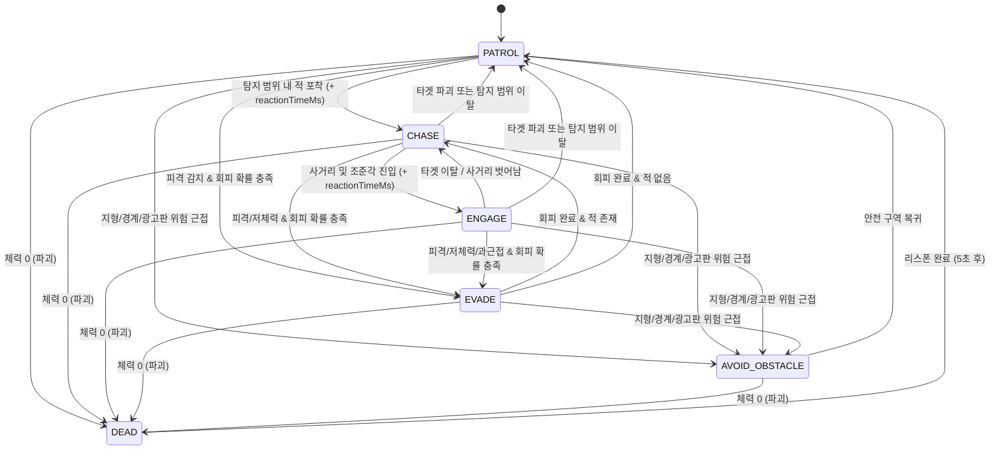
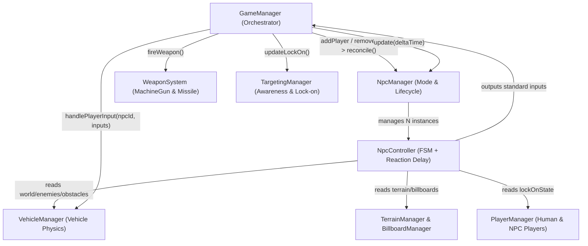

# NPC Player 요구사항 정의서

- **문서 버전:** v1.0
- **작성일:** 2026-11-24
- **대상 브랜치:** `stabilization`
- **대상 시스템:** Multiplayer 3D Vehicle Combat Game (`services/game-service`, `client`)

---

## 1. 개요

### 1.1 목적
실시간 멀티플레이어 3D 비행체 전투 게임에 자율 비행 및 전투를 수행하는 **NPC Player(AI 봇)**를 도입한다. 이를 통해 혼자 접속하거나 소수 인원이 플레이할 때도 정원 기반의 활성 전투 환경을 유지하고, 반응 시간 등 세부 파라미터로 난이도(능력치)를 유연하게 조절할 수 있도록 한다.

### 1.2 범위
- **포함 범위**
  - 서버 사이드 NPC 생명주기 관리 및 2가지 운영 모드(`fill`, `fixed`)
  - 반응 시간 기반 난이도/능력치 파라미터 체계 및 프리셋(`easy`, `normal`, `hard`)
  - NPC 자율 비행/전투/회피 AI 컨트롤러 (기존 `Vehicle.handleInput` 입력 인터페이스 재사용)
  - 기존 `GameManager`, `PlayerManager`, `VehicleManager`, `WeaponSystem`, `TargetingManager` 연동
  - `game-config.yaml` 기반 설정 외부화 및 상태 조회 API 확장
  - 클라이언트 플레이어 목록 내 NPC 식별 UI 표시
- **제외 범위 (향후 Phase)**
  - 머신러닝/강화학습 기반 AI
  - 팀전(Team Deathmatch) 전용 협동 전술 AI (현재 `gameMode: "deathmatch"` 기준)
  - NPC 전용 DB 영구 전적 저장 (`user-service` DB 스키마 변경 없음)

### 1.3 현재 시스템 기준 전제
| 항목 | 현재 값 / 구조 | 참조 위치 |
|---|---|---|
| 최대 정원 (`maxPlayers`) | `8` | `services/game-service/src/config/game-config.yaml` |
| 최소 시작 인원 (`minPlayersToStart`) | `1` | `services/game-service/src/config/game-config.yaml` |
| 서버 틱 레이트 (`tickRate`) | `60 Hz` | `services/game-service/src/config/game-config.yaml` |
| 비행체 타입 | `fighter`, `heavy`, `test` | `services/game-service/src/services/VehicleFactory.js` |
| 무기 시스템 | `machinegun`, `missile` (락온 기반) | `services/game-service/src/services/WeaponSystem.js` |
| 맵 크기 / 고도 제한 | `400 × 400`, `maxHeight: 200`, `boundaryBuffer: 10` | `services/game-service/src/config/game-config.yaml` |
| 리스폰 시간 | `5000 ms` | `services/game-service/src/config/game-config.yaml` |

---

## 2. 용어 정의

| 용어 | 정의 |
|---|---|
| **Human Player (유저)** | Socket.IO 및 JWT 인증을 거쳐 접속한 실제 사용자 (`isNpc: false`) |
| **NPC Player (봇)** | 서버 내부 AI가 제어하는 가상 플레이어 (`isNpc: true`) |
| **정원 (`maxPlayers`)** | 한 게임에 동시 참여할 수 있는 최대 인원 (`Human + NPC <= maxPlayers`) |
| **꽉채우는 모드 (`fill`)** | 정원(`maxPlayers`)의 빈 슬롯을 NPC로 자동 채우고, 유저 입장 시 NPC를 1명씩 제거하며 퇴장 시 보충하는 기본 모드 |
| **지정 개수 모드 (`fixed`)** | 설정된 목표 개수(`fixedCount`)만큼 NPC를 유지하는 모드 |
| **반응 시간 (`reactionTimeMs`)** | NPC가 상황 변화(적 포착, 피격, 회피 필요, 사격/미사일 조건 충족)를 인지한 뒤 실제 조작 입력으로 반영하기까지의 지연 시간 |

---

## 3. 기능 요구사항 (Functional Requirements)

### FR-01. NPC 운영 모드 및 정원 관리

#### FR-01-1. `fill` 모드 — 꽉채우는 모드 (기본값)
- 서버의 기본 NPC 운영 모드는 `fill`로 동작한다.
- 목표 NPC 수는 아래 공식으로 계산한다.
  $$\text{targetNpcCount} = \max(0,\; \text{maxPlayers} - \text{humanCount})$$
- **유저 입장 시:**
  - 현재 총 플레이어 수(`humanCount + npcCount`)가 `maxPlayers`에 도달했더라도 `npcCount > 0`이면 **NPC 1명을 먼저 제거**하여 슬롯과 색상을 확보한 뒤 유저를 입장시킨다.
  - 실제 유저만으로 `maxPlayers`가 가득 찬 경우(`humanCount >= maxPlayers`)에만 기존과 동일하게 `Game is full`을 반환한다.
- **유저 퇴장 시:**
  - 퇴장 후 `npcCount < targetNpcCount`가 되면 부족한 수만큼 NPC를 자동 보충한다.
- **유저 0명 상태 처리 (확정):**
  - 접속 중인 유저가 0명이면 **NPC는 동작하지 않는다** (`keepAliveWhenEmpty: false` 고정 기본 정책).
  - 마지막 유저가 퇴장하면 모든 NPC를 즉시 제거하여 서버 리소스를 절약하고, 첫 유저가 입장할 때 모드 정책에 따라 NPC를 즉시 스폰한다.

#### FR-01-2. `fixed` 모드 — 지정 개수 모드
- 설정값 `fixedCount`($\ge 0$)만큼 NPC를 생성 및 유지한다.
- **정원 우선 정책 (`prioritizeHumans`, 기본값 `true`):**
  - `humanCount + fixedCount <= maxPlayers`인 동안은 `fixedCount`개의 NPC를 유지한다.
  - 유저가 늘어나 `humanCount + fixedCount > maxPlayers`가 되면 실제 유저 입장을 우선하여 NPC를 1명씩 줄여 `targetNpcCount = min(fixedCount, max(0, maxPlayers - humanCount))`를 유지한다.
  - 이후 유저가 퇴장해 여유 슬롯이 생기면 다시 `fixedCount`까지 NPC를 복구한다.
- `prioritizeHumans: false`로 설정한 경우, NPC 슬롯을 고정 예약하며 남은 `maxPlayers - fixedCount` 슬롯만 유저에게 허용한다.

#### FR-01-3. 제거 대상 NPC 선정 우선순위
유저 입장 또는 설정 변경으로 NPC를 제거해야 할 때, 게임 경험 저하를 최소화하기 위해 아래 우선순위로 제거한다.
1. 현재 파괴되어 리스폰 대기 중인 NPC (`vehicle.active === false`)
2. 실제 유저와 교전 중이 아닌(최근 피격/타겟팅 이력이 없는) NPC
3. 가장 먼저 생성된(오래된) NPC

#### FR-01-4. 런타임 설정 조회 및 동적 변경 API (확정)
- 기본 설정은 `game-config.yaml`에서 로드하며, **REST API를 통해 서버 재시작 없이 런타임에 모드·개수·난이도를 동적으로 변경**할 수 있어야 한다.
- **엔드포인트 명세 (`game-service`, Nginx 경유 시 `/api/game/api/npc/config`, JWT 인증 적용):**
  - `GET /api/npc/config`: 현재 NPC 설정(`enabled`, `mode`, `fixedCount`, `defaultDifficulty`, `difficulties`) 및 활성 NPC 요약 목록(`id`, `name`, `vehicleType`, `difficulty`) 반환.
  - `PUT /api/npc/config`: 런타임 설정 변경 요청 처리.
    - 변경 가능 필드: `enabled`, `mode` (`"fill"` | `"fixed"`), `fixedCount` (`0 ~ maxPlayers`), `defaultDifficulty` (`"easy"` | `"normal"` | `"hard"` | `"mixed"`), `difficultyWeights`, `difficulties` (특정 난이도의 `reactionTimeMs` 등 세부 능력치 부분 오버라이드 포함).
    - **입력값 검증:** 유효하지 않은 `mode`, `defaultDifficulty`, 음수/범위 초과 수치 요청 시 `400 Bad Request`와 오류 메시지 반환.
    - **즉시 반영:** 설정 변경 즉시 `NpcManager.reconcile()`를 실행해 NPC 증감을 반영하고, 난이도/세부 파라미터가 변경된 경우 현재 활성 NPC 컨트롤러의 능력치 프로필도 즉시 갱신한다.
- `GET /api/status` 응답에도 현재 `humanPlayers`, `npcPlayers`, `npcConfig` 요약을 포함한다.

#### FR-01-5. NPC 비행체 타입 및 네이밍 규칙 (확정)
- **비행체 타입:** `fighter`와 `heavy`를 **랜덤 혼합**하여 생성한다 (`vehicleTypes: ["fighter", "heavy"]`).
- **이름 규칙:** 식별이 용이하도록 `NPC1`, `NPC2`, `NPC3`, ... 형식을 사용한다.
  - NPC 생성 시 현재 활성 NPC가 사용 중이지 않은 가장 작은 양의 정수(`1, 2, 3, ...`)를 할당한다(예: `NPC2`가 제거된 뒤 새 NPC가 스폰되면 `NPC2` 재사용).
- **교전 대상 범위:** Deathmatch 규칙을 따라 **NPC는 유저뿐만 아니라 다른 NPC와도 교전**한다(자기 자신 제외 모든 활성 비행체 대상).

---

### FR-02. NPC 난이도 및 능력치 조절

#### FR-02-1. 난이도 프리셋 및 커스텀 파라미터
- 난이도는 `easy`, `normal`, `hard` 3단계 프리셋을 기본 제공하며, `game-config.yaml`에서 각 항목을 자유롭게 조정할 수 있다.
- **공정성 원칙:** NPC는 플레이어와 동일한 비행체 물리 스펙(`maxSpeed`, `acceleration`, `health`, `weapon damage/cooldown`)을 사용하며, 능력치 차이는 **AI의 반응 속도, 판단 주기, 조준 정밀도, 기동 활용도, 무기 사용 판단**으로 구현한다.

#### FR-02-2. 난이도 조절 파라미터 명세
| 파라미터 | 단위/범위 | 설명 | Easy (예시) | Normal (예시) | Hard (예시) |
|---|---|---|---|---|---|
| `reactionTimeMs` | ms ($\ge 0$) | 상황 변화 인지 후 행동/사격 반영까지 지연 시간 | `650` | `300` | `100` |
| `decisionIntervalMs` | ms ($\ge 50$) | AI 상태 평가 및 타겟 재선정 주기 | `400` | `200` | `80` |
| `aimErrorDeg` | 도 ($^\circ$) | 사격 시 목표 방향에 추가되는 조준 오차 범위 | `12.0` | `5.0` | `1.5` |
| `leadTargetFactor` | `0.0 ~ 1.0` | 이동 중인 적의 미래 위치 예측(리드샷) 반영률 | `0.0` | `0.45` | `0.85` |
| `turnRateScale` | `0.1 ~ 1.0` | 비행체 최대 회전 속도 대비 NPC 조향 입력 배율 | `0.55` | `0.8` | `1.0` |
| `throttleScale` | `0.1 ~ 1.0` | 추력/부스터 활용 강도 | `0.6` | `0.8` | `1.0` |
| `detectionRange` | 유닛 | 적 비행체 탐지 및 추적 개시 최대 거리 | `180` | `260` | `360` |
| `fireRange` | 유닛 | 기관총 사격 개시 최대 거리 | `150` | `220` | `280` |
| `fireAngleDeg` | 도 ($^\circ$) | 기관총 사격을 허용하는 정면 조준각 임계값 | `18` | `12` | `8` |
| `fireBurstMs` | ms | 1회 연속 사격 지속 시간 | `450` | `800` | `1200` |
| `fireRestMs` | ms | 연사 후 다음 사격까지 휴지 시간 | `900` | `450` | `150` |
| `missileUseChance` | `0.0 ~ 1.0` | 락온 완료 시 미사일 발사 확률 | `0.2` | `0.6` | `0.95` |
| `missileReactionMs` | ms | 락온 완료 후 미사일 발사까지 추가 지연 | `1000` | `450` | `150` |
| `evasionChance` | `0.0 ~ 1.0` | 피격/위협 상황에서 회피 기동으로 전환할 확률 | `0.25` | `0.6` | `0.9` |
| `evasionHealthRatio` | `0.0 ~ 1.0` | 회피 기동을 우선 고려하는 체력 비율 임계값 | `0.3` | `0.45` | `0.6` |

#### FR-02-3. 난이도 배정 정책
- `defaultDifficulty`: 단일 난이도 일괄 적용 (`easy` | `normal` | `hard` | `mixed`).
- `mixed` 선택 시 `difficultyWeights`(예: `easy: 30, normal: 50, hard: 20`)에 따라 각 NPC 생성 시 난이도를 배정한다.

---

### FR-03. NPC AI 행동 로직 (FSM)

#### FR-03-1. 상태 전이 구조


#### FR-03-2. 상태별 세부 행동
1. **AVOID_OBSTACLE (최우선 안전 회피)**
   - **지형 회피:** 현재 위치 및 전방 예측 위치의 `TerrainManager.getTerrainHeight(x, z)` 대비 최소 안전 고도(예: `+25` 유닛) 미만일 경우 기수 상승(`pitch > 0`) 및 수직 상승(`vertical = 1`).
   - **맵 경계 회피:** `|x|` 또는 `|z|`가 `world.size / 2 - boundaryBuffer - 35`를 초과하거나 `y > world.maxHeight - 25`에 도달하면 맵 중앙 `(0, 100, 0)` 방향으로 강제 선회.
   - **광고판 회피:** 활성 `Billboard` 중심과 일정 거리 이내로 접근 시 측면/상방으로 선회하며, 충돌 발생 시에도 제자리 끼임(stuck) 없이 이탈.
2. **PATROL (순찰)**
   - 맵 내부 안전 고도(`minHeight ~ maxHeight` 구간, 예: `60 ~ 140`)에서 랜덤 웨이포인트를 생성하고 순회 비행.
   - 웨이포인트 도달(반경 25 유닛 이내) 또는 일정 시간(예: 12초) 경과 시 새 웨이포인트 갱신.
3. **CHASE (추적)**
   - 타겟 선정: 탐지 범위(`detectionRange`) 내 활성 적 비행체 중 거리 및 최근 자신을 공격한 적 가중치를 고려해 선정.
   - 타겟 방향(및 `leadTargetFactor` 적용 예측 위치)으로 `yaw`, `pitch`, `roll`, `thrust` 입력 생성.
4. **ENGAGE (교전)**
   - 타겟이 `fireRange` 이내이고 조준각이 `fireAngleDeg` 이내일 때, `reactionTimeMs` 지연 후 기관총 발사(`fire: true`).
   - `aimErrorDeg`에 따른 조준 편차를 적용하고 `fireBurstMs` / `fireRestMs` 주기로 연사와 휴지를 반복.
   - `TargetingManager`에 의해 `player.lockOnState.isLocked === true`가 되면 `missileReactionMs` 경과 후 `missileUseChance`에 따라 미사일 발사(`fireMissile: true`).
5. **EVADE (회피)**
   - 피격 이벤트(`vehicleHit`) 또는 저체력(`evasionHealthRatio` 이하) 시 `reactionTimeMs` 후 일정 시간(예: 2~3초) 동안 급선회 + 고도 변화 + 최대 추력 기동 수행.
6. **DEAD (파괴/리스폰)**
   - 파괴 시 모든 입력을 `0 / false`로 초기화하고 기존 5초 리스폰 타이머를 따른다.

#### FR-03-3. 입력 생성 인터페이스
- NPC 컨트롤러는 매 업데이트마다 기존 플레이어와 동일한 입력 객체를 생성해 `GameManager.handlePlayerInput(npcId, inputs)`로 전달한다.
  ```js
  {
    thrust: -1 ~ 1,
    pitch: -1 ~ 1,
    yaw: -1 ~ 1,
    roll: -1 ~ 1,
    vertical: -1 ~ 1,
    fire: boolean,
    fireMissile: boolean
  }
  ```

---

### FR-04. 기존 시스템 연동 요구사항

| 대상 모듈 | 요구 변경 사항 |
|---|---|
| `PlayerManager` | 플레이어 객체에 `isNpc: boolean`, `difficulty: string \| null` 필드 추가. `getHumanPlayers()`, `getNpcPlayers()`, `getHumanCount()`, `getNpcCount()` 헬퍼 제공. |
| `GameManager` | `NpcManager` 주입 및 `update(deltaTime)` 루프 내 `npcManager.update(deltaTime)` 실행. `addPlayer()` 시 `fill`/`fixed` 정책에 따라 슬롯 확보 후 입장 처리, `removePlayer()` 시 NPC 보충 조정. 리스폰 타이머(`respawnTimers` Map) 관리로 **제거된 NPC가 5초 뒤 유령 리스폰되는 버그 방지**. |
| `GameStateManager` | 실제 유저 수(`humanCount`) 기준으로 게임 활성/대기 전환 유지 (유저 0명 시 대기 전환 및 NPC 전체 정리). |
| `TargetingManager` / `WeaponSystem` | NPC를 일반 플레이어와 동등한 피격·타겟팅·락온·득점 대상으로 처리하며, NPC끼리도 상호 타겟팅/교전 수행. |
| `UIManager` (클라이언트) | 플레이어 목록(`updatePlayerList`)에서 `player.isNpc === true`인 항목에 `[NPC]`(또는 `🤖`) 표식 및 난이도 배지 표시 (`NPC1`, `NPC2` 등과 함께 명확히 구분). |

---

## 4. 비기능 요구사항 (Non-Functional Requirements)

1. **성능 (Performance)**
   - `maxPlayers: 8` 전체가 NPC로 동작하는 환경에서도 서버 게임 루프(60Hz)가 `maxFrameTime(33ms)` 이하를 유지해야 한다.
   - AI 의사결정(타겟 탐색, 웨이포인트/상태 평가)은 매 틱(16ms)이 아닌 `decisionIntervalMs` 주기로 수행하고, 매 틱에서는 계산된 목표 입력 적용과 경량 경계 체크만 수행한다.
2. **아키텍처 (SOLID 준수)**
   - `NpcManager`: NPC 스폰/제거, 모드(`fill`/`fixed`) 기반 인원 조정, 난이도 프로필 관리 (SRP).
   - `NpcController`: 개별 NPC의 FSM, 반응 시간 지연 처리, 조향/사격 입력 계산 (SRP).
   - 기존 `Vehicle`, `WeaponSystem`, `CollisionSystem`의 핵심 로직은 수정 없이 재사용 (OCP).
3. **설정 외부화 (No Hardcoding)**
   - 모든 모드, 정원 정책, 난이도 프리셋, NPC 이름 풀, 비행체 타입 가중치는 `services/game-service/src/config/game-config.yaml`에서 로드한다.
4. **안정성 (Stability)**
   - 빠른 연속 입/퇴장 시에도 `PlayerManager`의 색상 풀(`usedColors`), `VehicleManager`, `WeaponSystem`, 리스폰 타이머에 누수(leak)가 없어야 한다.
   - NPC 제거 시 진행 중이던 리스폰 타이머를 반드시 `clearTimeout`한다.

---

## 5. 아키텍처 및 모듈 설계 개요



### 예상 추가/수정 파일
- **신규**
  - `services/game-service/src/services/NpcManager.js`
  - `services/game-service/src/ai/NpcController.js`
- **수정**
  - `services/game-service/src/config/game-config.yaml` (`npc` 설정 섹션 추가)
  - `services/game-service/src/services/PlayerManager.js` (`isNpc`, `difficulty` 지원)
  - `services/game-service/src/services/GameManager.js` (`NpcManager` 연동 및 리스폰 타이머 관리)
  - `services/game-service/src/index.js` (`/api/status` NPC 통계 노출 + `GET/PUT /api/npc/config` 동적 제어 API 추가)
  - `client/js/ui/UIManager.js` (플레이어 목록 NPC 식별 표식)

---

## 6. 설정 스키마 (`game-config.yaml`)

```yaml
npc:
  enabled: true                      # NPC 시스템 활성화 여부
  mode: "fill"                       # "fill" (꽉채우는 모드, 기본) | "fixed" (지정 개수 모드)
  fixedCount: 3                      # mode가 "fixed"일 때 유지할 NPC 수
  keepAliveWhenEmpty: false          # 접속 유저가 0명일 때 NPC 동작 안 함 (확정)
  prioritizeHumans: true             # fixed 모드에서 정원 초과 시 유저 입장 우선 여부
  defaultDifficulty: "normal"        # "easy" | "normal" | "hard" | "mixed"
  difficultyWeights:                 # defaultDifficulty가 "mixed"일 때 가중치
    easy: 30
    normal: 50
    hard: 20
  vehicleTypes: ["fighter", "heavy"] # fighter / heavy 랜덤 혼합
  namePrefix: "NPC"                  # NPC1, NPC2, NPC3 ... 순번 부여

  difficulties:
    easy:
      reactionTimeMs: 650
      decisionIntervalMs: 400
      aimErrorDeg: 12.0
      leadTargetFactor: 0.0
      turnRateScale: 0.55
      throttleScale: 0.6
      detectionRange: 180
      fireRange: 150
      fireAngleDeg: 18
      fireBurstMs: 450
      fireRestMs: 900
      missileUseChance: 0.2
      missileReactionMs: 1000
      evasionChance: 0.25
      evasionHealthRatio: 0.3
    normal:
      reactionTimeMs: 300
      decisionIntervalMs: 200
      aimErrorDeg: 5.0
      leadTargetFactor: 0.45
      turnRateScale: 0.8
      throttleScale: 0.8
      detectionRange: 260
      fireRange: 220
      fireAngleDeg: 12
      fireBurstMs: 800
      fireRestMs: 450
      missileUseChance: 0.6
      missileReactionMs: 450
      evasionChance: 0.6
      evasionHealthRatio: 0.45
    hard:
      reactionTimeMs: 100
      decisionIntervalMs: 80
      aimErrorDeg: 1.5
      leadTargetFactor: 0.85
      turnRateScale: 1.0
      throttleScale: 1.0
      detectionRange: 360
      fireRange: 280
      fireAngleDeg: 8
      fireBurstMs: 1200
      fireRestMs: 150
      missileUseChance: 0.95
      missileReactionMs: 150
      evasionChance: 0.9
      evasionHealthRatio: 0.6
```

---

## 7. 인수 조건 (Acceptance Criteria)

| ID | 테스트 시나리오 | 기대 결과 |
|---|---|---|
| **AC-01** | `mode: "fill"`, `maxPlayers: 8`에서 첫 유저 입장 | 총 인원 8명(유저 1 + NPC 7)이 되며 모든 NPC가 정상 비행 및 전투 수행 |
| **AC-02** | AC-01 상태에서 2번째, 3번째 유저 순차 입장 | 유저가 입장할 때마다 NPC가 1명씩 제거되어 총 8명(유저 2+NPC 6 → 유저 3+NPC 5) 유지 |
| **AC-03** | AC-02 상태에서 유저 1명 퇴장 | NPC 1명이 자동 보충되어 다시 총 8명 유지 |
| **AC-04** | 유저 8명 모두 입장 후 9번째 유저 입장 시도 | NPC는 0명이 되며, 9번째 유저는 `Game is full` 응답 수신 |
| **AC-05** | `mode: "fixed"`, `fixedCount: 3`에서 유저 1명 입장 | NPC 정확히 3명 스폰(총 4명). 유저가 6명이 되면 `prioritizeHumans: true` 기준 NPC가 2명으로 자동 축소되고, 퇴장 시 3명으로 복구 |
| **AC-06** | 난이도 `easy` vs `hard` 비교 테스트 | `hard` NPC가 `easy` 대비 확실히 짧은 반응 시간, 높은 명중률, 적극적인 미사일 사용 및 회피 기동 수행 |
| **AC-07** | 지형/맵 경계/광고판 근접 비행 | NPC가 지면 추락·경계 끼임·광고판 고착(stuck) 없이 안전하게 회피 비행 |
| **AC-08** | NPC 격추 및 리스폰 | 유저가 NPC 격추 시 폭발·점수·킬 정상 반영, 5초 후 NPC 리스폰. 리스폰 대기 중 유저 입장으로 해당 NPC가 제거되면 5초 후 유령 리스폰 미발생 |
| **AC-09** | 클라이언트 플레이어 목록 및 락온 UI | 플레이어 목록에 `NPC1`, `NPC2` ... 이름 및 NPC 식별 표시, NPC 비행체에 정상적으로 상황인식(녹색)/락온(노란색) 박스 표시 |
| **AC-10** | 유저 0명 상태 검증 | 마지막 유저 퇴장 시 모든 NPC가 즉시 제거되고 게임이 `waiting` 상태로 전환되며 AI 루프 미실행 |
| **AC-11** | NPC 간 상호 교전 | 유저 외 다른 NPC끼리도 서로 추적·사격·미사일 공격 및 격추 수행 |
| **AC-12** | REST API 동적 설정 변경 | `PUT /api/npc/config`로 `mode`(`fill` ↔ `fixed`), `fixedCount`, `defaultDifficulty`, `reactionTimeMs` 변경 시 서버 재시작 없이 즉시 반영되며, 잘못된 값은 `400` 반환 |

---

## 8. 확정 정책 요약 (Confirmed Decisions)

| 항목 | 확정 내용 |
|---|---|
| 유저 0명 시 동작 | NPC 동작 없음 (`keepAliveWhenEmpty: false`, 마지막 유저 퇴장 시 즉시 제거, 첫 유저 입장 시 스폰) |
| NPC 교전 대상 | NPC끼리도 서로 전투 수행 (Deathmatch, 자기 자신 제외 모든 활성 비행체) |
| 모드/난이도 설정 방식 | `game-config.yaml` 기본 설정 + `GET/PUT /api/npc/config` REST API로 런타임 동적 변경 지원 |
| 비행체 타입 및 네이밍 | `fighter`, `heavy` 랜덤 혼합 / 이름은 `NPC1`, `NPC2`, `NPC3` ... 순번 부여 |
