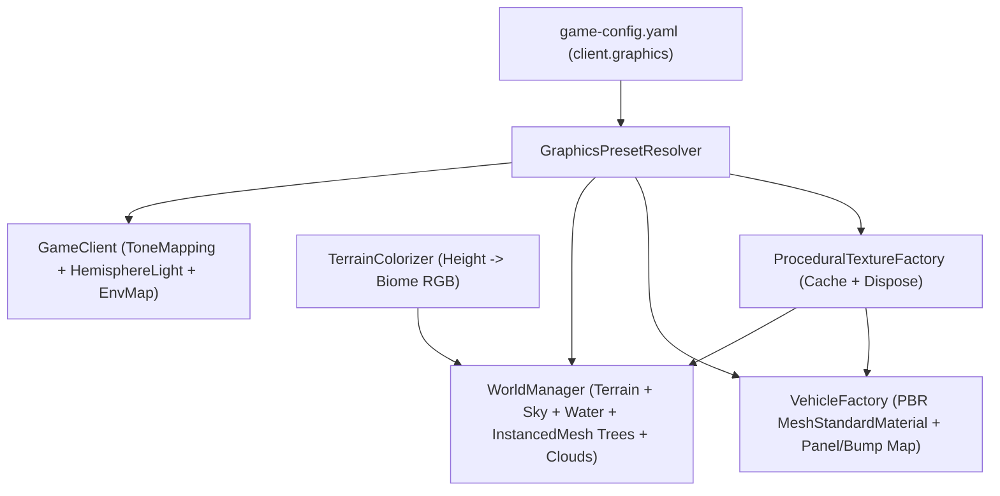

# 비주얼 & 텍스처 업그레이드(Visual Upgrade) 상세 설계서

- **문서 버전:** v1.0
- **작성일:** 2026-11-24
- **대상 브랜치:** `stabilization`
- **연관 문서:** [VISUAL_UPGRADE_REQUIREMENTS.md](./VISUAL_UPGRADE_REQUIREMENTS.md)

---

## 1. 모듈 구조 (SOLID)

```
client/js/graphics/
├── GraphicsPresetResolver.js    # SRP/OCP: low/medium/high 프리셋 해석 및 기본값 병합
├── TerrainColorizer.js          # SRP: 지형 고도 기반 바이옴 버텍스 컬러 보간 계산
└── ProceduralTextureFactory.js  # SRP/DIP: CanvasTexture 생성·캐싱·해제 (sky/terrain/water/vehicle)
```



---

## 2. 모듈별 상세 설계

### 2.1 `GraphicsPresetResolver` (`client/js/graphics/GraphicsPresetResolver.js`)
- `DEFAULT_GRAPHICS_PRESETS`: `low`, `medium`, `high` 기본 프리셋 정의
  - `low`: `textureSize: 128`, `enableEnvironmentMap: false`, `toneMappingExposure: 1.05`, `waterScrollSpeed: 0.02`, `cloudPuffs: 2`
  - `medium`: `textureSize: 256`, `enableEnvironmentMap: true`, `toneMappingExposure: 1.1`, `waterScrollSpeed: 0.03`, `cloudPuffs: 3`
  - `high`: `textureSize: 512`, `enableEnvironmentMap: true`, `toneMappingExposure: 1.15`, `waterScrollSpeed: 0.035`, `cloudPuffs: 4`
- `resolveGraphicsConfig(clientConfig)`:
  - `clientConfig.graphics.preset`과 `clientConfig.graphics.presets[preset]` 및 상위 오버라이드를 병합해 최종 설정 객체 반환.
  - 유효하지 않은 프리셋 이름은 `'medium'`으로 안전 폴백.

### 2.2 `TerrainColorizer` (`client/js/graphics/TerrainColorizer.js`)
- `DEFAULT_BIOME_STOPS`: 고도 임계치별 RGB 팔레트
  - `<= -2`: 모래사장 (`#c8b588`)
  - `12`: 저지대 초원 (`#4f7942`)
  - `28`: 고지대 숲/이끼 (`#3e5c3a`)
  - `42`: 암석 산악 (`#6e6a64`)
  - `>= 58`: 설원 정상 (`#e6edf2`)
- `getColorForHeight(height)`: 인접한 두 정지점 사이를 선형 보간해 `{ r, g, b }` (`0..1`) 반환.
- `buildVertexColors(positionArray)`: `PlaneGeometry`의 정점 배열에서 높이(`z` 성분)를 읽어 `Float32Array` 버텍스 컬러 버퍼 생성.

### 2.3 `ProceduralTextureFactory` (`client/js/graphics/ProceduralTextureFactory.js`)
- 생성자 `(graphicsConfig, deps = {})`:
  - `deps.createCanvas`: 기본 `() => document.createElement('canvas')` (Node 단위 테스트에서 mock canvas 주입 가능 — DIP).
  - `deps.createTexture`: 기본 `(canvas) => new THREE.CanvasTexture(canvas)`.
- 캐시 맵 `this.cache = new Map()`으로 동일 텍스처 재생성 방지:
  1. `getSkyTexture()`: 천정(`skyTopColor`) → 중천(`skyMidColor`) → 지평선(`skyHorizonColor`) 세로 그라데이션 + 은은한 태양 광휘.
  2. `getTerrainDetailTexture()`: 미세 그레인 노이즈 텍스처 (`RepeatWrapping`, `repeat: 16×16`).
  3. `getWaterTexture()`: 부드러운 물결/하이라이트 패턴 (`RepeatWrapping`, `repeat: 12×12`).
  4. `getVehiclePanelTextures()`: 금속 패널 이음선 + 리벳 + 미세 브러시드 메탈 질감의 `{ map, bumpMap }` 쌍 (`RepeatWrapping`).
- `dispose()`: 캐시된 모든 텍스처의 `.dispose()` 호출 및 캐시 초기화.

### 2.4 기존 클래스 연동
- **`GameClient.js`**:
  - `initThreeJS()`: `renderer.toneMapping = THREE.ACESFilmicToneMapping`, `renderer.toneMappingExposure = graphics.toneMappingExposure`, `scene.fog`를 지평선 색상과 일치.
  - `setupLighting()`: `HemisphereLight(skyColor, groundColor, intensity)` + `DirectionalLight` + `enableEnvironmentMap` 시 `PMREMGenerator` + `RoomEnvironment` 적용 (`this.envRenderTarget` 저장 후 `cleanup()` 시 `dispose()`).
  - `init()`: `this.textureFactory = new ProceduralTextureFactory(this.graphicsConfig)` 생성 후 `WorldManager`와 `VehicleFactory`에 주입(DIP).
  - `animate()`: `this.worldManager.updateWater(deltaTime)` 호출 추가.
  - `cleanup()`: `this.textureFactory.dispose()`, `this.envRenderTarget.dispose()`.
- **`WorldManager.js`**:
  - `createTerrain()`: `TerrainColorizer`로 `color` 버텍스 속성 추가 + `MeshStandardMaterial({ vertexColors: true, map: terrainDetailTex, roughness: 0.92, metalness: 0.02 })`.
  - `createSky()`: `getSkyTexture()` 적용.
  - `createWater()`: `MeshStandardMaterial({ map: waterTex, color, transparent: true, opacity, roughness: 0.18, metalness: 0.25 })` + `updateWater(deltaTime)`에서 UV `offset.x/y` 스크롤.
  - `createTrees()`: 줄기(`CylinderGeometry`) + 하단 잎(`ConeGeometry`) + 상단 잎(`ConeGeometry`)을 각각 `THREE.InstancedMesh` 1개씩(총 3개 드로우콜)으로 배치하고 인스턴스별 색상 미세 변주 적용.
  - `createClouds()`: `cloudPuffs` 개수만큼 구체를 조합한 뭉게구름 그룹 생성.
- **`VehicleFactory.js`**:
  - `createVehicleBodyMaterial(color)`: `MeshStandardMaterial({ color, map: panel.map, bumpMap: panel.bumpMap, bumpScale: 0.08, metalness: 0.55, roughness: 0.35 })`.
  - `createCockpitMaterial()`: 반사감 있는 틴티드 글래스 `MeshStandardMaterial({ color: 0x99d6ff, metalness: 0.2, roughness: 0.08, transparent: true, opacity: 0.55 })`.

---

## 3. 테스트 전략
1. **단위 테스트 (`services/game-service/tests/unit/visual-graphics.test.js`)**:
   - `GraphicsPresetResolver`: 프리셋 해석, 오버라이드, 잘못된 프리셋 폴백 검증
   - `TerrainColorizer`: 저고도/중고도/고고도 바이옴 색상 보간 및 `buildVertexColors` 버퍼 길이/범위 검증
   - `ProceduralTextureFactory`: mock canvas/texture로 4종 텍스처 생성, 캐싱(동일 참조 반환), `dispose()` 해제 검증
2. **Playwright Headless Browser E2E (`tests/e2e/visual-upgrade.spec.js`)**:
   - `http://localhost` 입장 후 `pageerror` 0건
   - `renderer.toneMapping === THREE.ACESFilmicToneMapping` 확인
   - `scene` 내 `HemisphereLight`, `InstancedMesh` 나무, `vertexColors` 지형 텍스처, `MeshStandardMaterial` + `map`/`bumpMap` 비행체 확인
   - 1초 경과 후 수면 텍스처 UV `offset` 변화 확인
   - `나가기` → 재입장 후 정상 렌더링 확인
